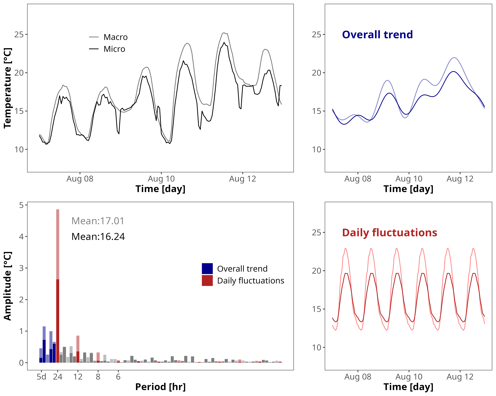

```{r set}
#| message: false
# devtools::install_github("sylvainschmitt/microclimr")
library(tidyverse)
library(dataverse)
library(microclimr)
library(maps)
library(colorspace)
library(terra)
```

```{r rawdata}
#| eval: false
plots <- list(
  Aigoual = "10.48579/PRO/RSBT3C/VDNSLZ",
  Blois = "10.48579/PRO/RSBT3C/37MKWL",
  Mormal = "10.48579/PRO/RSBT3C/IJAKFT"
) |> 
  lapply(get_dataframe_by_doi, server = "data.indores.fr") %>%
  bind_rows(.id = "site")
write_tsv(plots, "data/plots.tsv")
plots %>%
  group_by(site) %>%
  summarise(lon = mean(longwgs84), lat = mean(latwgs84)) %>%
  write_tsv("data/coords.tsv")
temperatures <- list(
  Aigoual = "10.48579/PRO/ZQBQUW/MK2F35",
  Blois = "10.48579/PRO/ZQBQUW/ZL0LOC",
  Mormal = "10.48579/PRO/ZQBQUW/GBVNRR"
) %>%
  lapply(get_dataframe_by_doi, server = "data.indores.fr") %>%
  bind_rows(.id = "site")
lidar <- list(
  Aigoual = "10.48579/PRO/XH62TC/P4F7FP",
  Blois = "10.48579/PRO/XH62TC/OI6WQU",
  Mormal = "10.48579/PRO/XH62TC/5RXUGU"
) %>%
  lapply(get_dataframe_by_doi, server = "data.indores.fr") %>%
  bind_rows(.id = "site")
lidar_sub <- lidar %>%
  filter(buffer == 5) %>%
  rename(plot = idplot) %>%
  select(site, plot, pai)
era <- read_tsv("data/era.tsv") %>%
  mutate(site = recode(dim_0, "0" = "Aigoual", "1" = "Blois", "2" = "Mormal")) %>%
  mutate(datetime = as_datetime(time)) %>%
  rename(era = tas) %>%
  select(site, datetime, era)
onf <- list.files("data/methor_data_onf/", pattern = ".txt.gz", full.names = TRUE) %>%
  vroom::vroom(col_names = read_tsv("data/methor_data_onf/MetHor2018.org") %>%
    names()) %>%
  select(
    "Code placette",
    "Date",
    "Heure (TU)",
    "Température instantanée (°C)"
  ) %>%
  mutate(datetime = paste0(
    str_sub(Date, 7, 10), "-",
    str_sub(Date, 4, 5), "-",
    str_sub(Date, 1, 2), " ",
    str_sub(`Heure (TU)`, 1, 2), ":",
    str_sub(`Heure (TU)`, 3, 4), ":00"
  )) %>%
  mutate(datetime = as_datetime(datetime)) %>%
  rename(onf = "Température instantanée (°C)", plot = "Code placette") %>%
  filter(plot %in% c("CHP 59", "CHS 41", "HET 30")) %>%
  mutate(site = recode(plot,
    "CHP 59" = "Mormal",
    "CHS 41" = "Blois", "HET 30" = "Aigoual"
  )) %>%
  select(site, datetime, onf) %>%
  mutate(onf = gsub(",", ".", onf)) %>%
  mutate(onf = as.numeric(onf))
data <- temperatures %>%
  mutate(datetime = as_datetime(datetime)) %>%
  rename(
    hobo = t_hobo, plot = id_plot, sensor = id_sensor,
    position = position_sensor
  ) %>%
  mutate(position = recode(position, "a" = "air", "s" = "soil")) %>%
  select(site, plot, sensor, position, datetime, hobo) %>%
  left_join(era) %>%
  left_join(onf) %>%
  left_join(lidar_sub)
write_tsv(data, "data/data.tsv.gz")
```

```{r decomposition}
#| eval: false
data <- read_tsv("data/data.tsv.gz")
fc <- data %>%
  filter(month(datetime) %in% 5:9) %>%
  gather(
    source, temperature,
    -site, -plot, -sensor, -position, -datetime, -pai
  ) %>%
  group_by(source, site, plot, sensor, position, pai,
    datetime = floor_date(datetime, "2 hour")
  ) %>%
  summarise(temperature = mean(temperature)) %>%
  group_by(source, site, plot, sensor, position, pai) %>%
  do(fft = fft_roll(
    data = .,
    time_window = 5 * 12,
    time_col = "datetime",
    temperature_col = "temperature",
    window = "5 days",
    step = "3 days"
  )) %>%
  unnest(fft)
write_tsv(fc, "data/decomposition.tsv.xz")
```

**Aim**: *Agricultural and Forest Meteorology*

**Cover letter**: [link](https://sylvainschmitt.github.io/fourier/cover_letter.html)

## Affiliations

1 - CIRAD, UPR Forêts et Sociétés, F-34398 Montpellier, France\
2 - Forêts et Sociétés, Univ Montpellier, CIRAD, Montpellier, France\
3 - UMR CNRS 7352 "Laboratoire Amiénois de Mathématique Fondamentale et Appliquée" (LAMFA), Université de Picardie Jules Verne, 33 rue St-Leu, 80000 Amiens, France\
4 - UMR CNRS 7058 “Ecologie et Dynamique des Systèmes Anthropisés” (EDYSAN), Université de Picardie Jules Verne, 1 rue des Louvels, 80000 Amiens, France

**Corresponding author**: Sylvain Schmitt

## Highlights

- Discrete Fourier Transform quantifies canopy buffering at any timescale at once
- Paired micro- and macroclimate series become amplitude and phase spectra
- Daily, seasonal and interannual buffering separated within one temperature record
- Spectral debiasing of ERA5-Land corrects mean bias and damped short-term variability
- Noise-robust framework complements offset and slope-equilibrium microclimate metrics

## Abstract

Quantifying how forest canopies buffer temperature fluctuations in the understorey is central to our understanding of biodiversity responses to anthropogenic climate change. However, existing metrics (i.e., the offset and slope-equilibrium approaches linking microclimate to macroclimate) capture the buffering effect of the canopy at a single, pre-defined timescale and cannot separate daily from seasonal and interannual signals within the same temperature time series. We introduce the Discrete Fourier Transform (DFT) as a tool for decomposing paired microclimate–macroclimate temperature time series into a harmonic spectrum with amplitude and phase per frequency, so that canopy buffering can be decomposed and quantified, all at once, for any timescale. We illustrate the approach with two case studies using subcanopy air and soil temperature records paired with weather-station and ERA5-Land reanalysis reference data. In the first case study, spectral decomposition isolated the dominant 24-hour cycle and showed that forest canopies buffered daily air-temperature fluctuations by 75.9–90.3% across sites, with forest soils buffering mean temperature even more strongly than air near the ground. In the second case study, the same framework was used to debias ERA5-Land reanalysis data against a local and ground-truth reference weather station by comparing amplitude spectra across frequencies, correcting both the overestimation of mean temperature and the underestimation of short-term variability. By resolving canopy buffering across multiple timescales within a single, noise-robust framework and by enabling principled debiasing of macroclimate reference products, the DFT approach that we tailored to microclimatic time series offers a versatile addition to the microclimate ecologist's toolkit, complementing rather than replacing existing offset and slope-equilibrium approaches.

### Keywords

amplitude spectrum; dampening effect; forest ecosystems; macroclimate debiasing; microclimate buffering; periodic signal; temperature time series; vegetation cover

## Graphical abstract

```{r graph_abstract}

```

## 1. Introduction

Microclimate ecology and biogeography has recently emerged as a burgeoning research field to better understand biodiversity distribution and redistribution under climate change [@kemppinen2024]. Historically, and prior to Rudolf Geiger (1894-1981) who first used the term microclimate [@geiger1965], the idea that climate can be modulated by vegetation cover was introduced by physicists, biogeographers and foresters such as Alexander von Humboldt (1769-1859), Louis Joseph Gay-Lussac (1778-1850), Antoine César Becquerel (1788-1878) and Jean-Baptiste Boussingault (1801-1887) [see @becquerel1865]. At that time, the socio-ecological context was very different because of the impact of massive deforestation on air quality and climate, such as in the Americas, after the arrival of European settlers.

In 1823, Boussingault travelled to Venezuela to study the drying up of the lake Valencia and confirmed von Humboldt's intuition that forests can modify local climatic conditions across large spatial extents [@fressoz2020], by holding water locally through reduced soil evaporation and increased tree transpiration [@becquerel1865]. Boussingault concluded on a cooling effect of forests on climate, reducing mean temperature while increasing annual precipitation, suggesting that deforestation across large regions tends to warm and dry the local climate [@fuster1845; @becquerel1865; @fressoz2020]. Although neither Von Humboldt nor Boussingault mentioned the term microclimate, they paved the way for the early discoveries on microclimatic processes. A few decades later, in "*Mémoire sur les forêts et leur influence climatérique*" (1865), Becquerel reported on the calorific influence of trees on air temperatures. He recorded local air temperatures at different hours of the day, for different days of the year, between January 1863 and July 1864, and for different localities and heights near, as well as away from, isolated trees, with or without leaves. He concluded, back in 1865, that wood from trees exposed to solar (shortwave) and nocturnal (longwave) radiations can warm up and cool down the contiguous air layers surrounding trees, a feature that adds up to the non-radiative cooling effect due to tree transpiration which was already well known by the time. Almost a century later, in 1950, microclimatology became an established field, thanks to the first English edition of Rudolf Geiger's book entitled "*The Climate Near The Ground*", which even percolated the field of epidemiology as a mean to better understand how atmospheric air conditions in confined environments (i.e., the early definition of microclimate) can drive diseases' transmission [@sorre1961notion].

Since the mid 1980s, the advent of microclimate sensors and metrological developments have allowed ecologists to better assess the magnitude of microclimate modulations due to vegetation cover, especially so in forest ecosystems [@defrenne2019; @defrenne2021]. The first metric used by foresters was the instantaneous difference in temperature measurements, i.e., the offset, obtained by a paired design of sensors located inside (micro) vs. outside (macro) the forest [@deFreitas1995; @carlson1997; @chen1999]. Back in 1865, Becquerel wrote, in French, translated here to English by the authors: "*one needs to analyse temperature records made inside and outside forested areas at the same latitude, under similar geological conditions and at the same height above sea level*". In a meta-analysis compiling offset values of daily temperatures from 74 studies relying on a strictly paired design and doing exactly what Becquerel suggested in 1865, @defrenne2019 have found that mean and maximum subcanopy temperatures were, on average, cooler than temperatures outside forests by 1.7 ± 0.3°C and 4.1 ± 0.5°C, respectively, a pattern which was even more pronounced in tropical forests compared to temperate or boreal forests. Another metric often used to assess microclimate modulations is the slope parameter of a linear model linking paired time series of hourly temperature records from a microclimate sensor located beneath forest canopies (micro) versus a neighboring weather station located outside the forest (macro), such that slope values lower and greater than 1 suggest buffering and amplifying effects of temperature fluctuations over time, respectively [@gril2023]. However, none of these two metrics allow for a direct decomposition of the periodic signal of temperature fluctuations over a long time series, in order to isolate daily fluctuations from seasonal variations and interannual trends. Here, we propose to fill this gap by using the Discrete Fourier Transform (DFT) on paired temperature time series, micro vs. macro, to decompose each temperature time series in a sum of its harmonics.

Each harmonic corresponds to a wave (cyclic) signal with its own range of variation (amplitude) and its own periodicity (frequency) to fulfill a complete cycle. Thanks to the DFT, any cyclic signal, such as temperature, can be written as a periodic function summing an infinity of harmonics and thus can be fully reconstructed by virtue of the knowledge of the ordered collection (vector) of amplitude values, called amplitude spectrum, and its corresponding vector of phase values, i.e., time shifts relative to the reference, called Fourier decomposition of the signal. By extracting the amplitude spectrum of both the microclimatic and macroclimatic temperature time series, it is then possible to analyse the vector of ratios of amplitude values (micro/macro), which corresponds to a full decomposition of microclimate modulations for increasing frequencies, such that ratio values lower and greater than 1 mean buffering and amplifying effects, respectively. It is then possible to isolate microclimate modulations for the frequency of interest (e.g., daily) to detrend the signal, i.e., ignoring lower-frequency signals (e.g., seasonal and interannual), and to remove potential noise due to the harmonics with very low amplitudes in the harmonic series.

To illustrate the relevance of the DFT for the field of microclimate ecology and biogeography, we present two case studies. First, we used the DFT to assess the buffering capacity of temperate deciduous forest ecosystems during the vegetation season. We rely on an existing dataset of subcanopy air and soil temperature time series from a network of microclimate loggers installed at 1-m height aboveground and 8-cm depth belowground, respectively, and beneath the canopy of three state forests in France [@gril2023; @gril2024; @gril2025]. This dataset is paired with a set of time series representing the reference temperature (macroclimate) extracted from either the ERA5-Land global reanalysis [@muñoz-sabater2021] or three reference and ground-truth weather stations located outside but nearby the three studied state forests. Second, because the choice of the macroclimatic reference matters to assess microclimatic modulations, we apply the DFT to debias a temperature time series from the ERA5-Land reanalysis at a local site where a paired time series from a ground-truth weather station is available so that this debiasing procedure can be implemented on another location where weather station data are unavailable.

## 2. The method: a spectral decomposition of temperature time series via the Discrete Fourier Transform (DFT)

Temperature records measured continuously over time --- whether by a sensor inside a plastic-coated microclimate logger installed in a closed-canopy forest or by a thermocouple inside a standardized weather station in an open field --- are producing inherently periodic signals. Daily heating and cooling swings, seasonal rhythms, and longer climatic cycles all superimpose upon one another to produce the complex thermal fluctuations that drive biodiversity distribution and redistribution under climate change. To disentangle these overlapping periodic signals and quantify how the forest modifies each of them independently, we propose to use the DFT to decompose temperature time series.

**Mathematical framework.** Consider a temperature time series sampled at regular intervals $\Delta t$ (here, hourly) over a total duration $T = N\Delta t$, where $N$ is the number of measurements. We denote by $t_{0},...,t_{N-1}$ the $N$ sampled times and $S(t_{0}),...,S(t_{N-1})$ the corresponding temperature records. The slowest fluctuation the method can detect is a single cycle spanning the entire time window, with frequency $1/T$. All other detectable fluctuations occur at frequencies that are multiples of this one, $f_{j} = j/T$ for $j = 1,...,N/2$; these are called modes, or harmonics. For each mode, the DFT computes two numbers: (1) an amplitude $A_{j}$, in degree celsius, describing how strongly that mode contributes to the temperature signal; and (2) a time lag $s_{j}$ describing how the mode is shifted in time relative to the start of the window, $t_{0}$. We use the Fast Fourier Transform (FFT), a standard numerical algorithm, to compute these values. Together, they allow the temperature signal to be reconstructed as a sum of cosine waves (a Fourier series):

$$\hat{T}(f_k) = \sum_{j=0}^{N-1} T(t_j)\, e^{-2\pi i\, j\, k / N}, \quad k = 0, 1, \ldots, N-1,$$

where $A_{0}$ is the mean temperature. Note that $f_{N/2}$, called the Nyquist frequency, is the fastest cycle the method can capture: fluctuations faster than this cannot be detected. The amplitude spectrum is the graph of $A_{j}$ against $f_{j}$ (or, equivalently, against $j$); it shows at a glance which modes contribute the most to the temperature signal (see next section). In @fig-proj, we show the amplitude spectrum for temperature time series recorded under both macroclimatic and microclimatic conditions.

To illustrate what each mode contributes, we reconstructed two time series over a 6-day window recorded hourly. The first, $S_{trend}(t)$, combines only the slowest modes --- those with cycles longer than one day --- and captures the overall trend of the temperature signal (@fig-proj). The second, $S_{daily}(t)$, combines the daily cycle together with its harmonics (i.e., the 24-hour, 12-hour, 8-hour cycles, and so on), and captures the recurring within-day pattern of warming and cooling (@fig-proj). Adding these two reconstructions together already gives a close approximation of the full signal $S(t)$, since the remaining modes contribute comparatively little --- see the [Supplementary note](https://sylvainschmitt.github.io/fourier/supplementary_note.html) for a quantification of how much variance each mode explains.

**Ecological interpretation.** Some frequencies in a temperature time series correspond to ecologically meaningful cycles. For example, the diurnal cycle (i.e., a period of 24 hours) has a frequency of 1/24 hour (see @fig-proj) --- note that a frequency is the inverse of the time period needed to complete a full cycle. Expressing temperature variability of paired time series between macroclimatic and microclimatic records along the frequency domain thus allows us to ask not simply "*how much cooler is the forest interior?*" but rather "*at which time periods does the forest attenuate or amplify climatic variability?*". Forest canopies are expected to buffer high-frequency (diurnal) fluctuations more strongly than low-frequency (seasonal) ones, because the underlying physical mechanisms --- thermal inertia of soil and litter, radiative shading and transpiration cooling of leaves as well as latent heat exchanges --- operate preferentially over short periods. As illustrated in @fig-proj, for a representative 6-day time series combining paired records of air temperature inside (micro) and outside (macro) a temperate deciduous forest, the spectral decomposition successfully resolves the signal into its constituent frequencies. For instance, the mean air temperature inside the forest (micro) over the 6 consecutive days is 16.24°C, reaching a diurnal amplitude of 2.64°C at the 24-hour period (i.e., the highest harmonic, henceforth referred as the 24-h amplitude). Over the same 6 days, the mean air temperature outside the forest (macro) is slightly warmer, being 17.01°C, and the 24-hour amplitude is much greater, reaching more than 4.86°C. Computing the 24-h amplitude ratio between microclimate (the numerator) and macroclimate (the denominator), we obtain a value of 0.54 over the 6 days while the ratio of mean air temperature between microclimate (the numerator) and macroclimate (the denominator) is 0.95 --- together revealing that the forest microclimate substantially buffers daily temperature fluctuations relative to the macroclimate while the average microclimatic conditions are slightly cooler (i.e., the mean offset over the 6 consecutive days is -0.77°C) inside than outside the forest. Plotting the 24-h amplitude ratio against the mean temperature ratio allows to quickly assess whether microclimatic conditions are either buffered (i.e., 24-h amplitude ratio \< 1) or amplified (i.e., 24-h amplitude ratio \> 1) and either cooler (i.e., mean temperature ratio \< 1) or warmer (i.e., mean temperature ratio \> 1) compared to macroclimate (see Case study 1).

```{r proj_freq}
#| label: fig-proj
#| message: false
#| warning: false
#| fig-width: 10
#| fig-height: 8
#| fig-cap: "Temperature time series decomposition, using the Discrete Fourier Transform (DFT), and reprojection for selected frequencies to isolate an overall trend in the time series. We used an example of paired (macroclimate vs. microclimate) hourly temperature time series from August 7th to August 12th 2023 (upper-left panel). The microclimate (Micro) time series was extracted from one microclimate logger (HOBO, dark lines) installed in plot #59_58 in the Mormal forest and recording sub-canopy air temperature at 1-m height above ground. The macroclimate (Macro) time series was extracted from one neighboring weather station located in an open landscape near the forest and managed by the “Office National des Forêts” (ONF, light lines): it follows the standards of the World Meteorological Organisation (WMO). The lower left panel represents the resulting amplitude spectrum after the DFT was applied on the 6-days long microclimate (HOBO, dark bars) and macroclimate (ONF, light bars) time series. Frequencies below 1/24h (i.e., periods longer than a day) are highlighted in blue (“Overall trend”) while the frequency at 1/24h and its corresponding harmonics are highlighted in red (“Daily fluctuations”). The resulting reconstruction of temperature time series for the highlighted frequencies are given in the upper right panel (overall trend in blue) and lower right panel (daily cyclic signal in red: detrended)."
Sys.setlocale("LC_TIME", "en_US.UTF-8") %>%
  invisible()
cols <- c("darkblue", "firebrick", "darkgrey")
data <- "data/data.tsv.gz" %>%
  read_tsv() %>%
  filter(
    year(datetime) == 2023,
    month(datetime) == 8
  ) %>%
  filter(
    position == "air",
    plot == "59_58"
  ) %>%
  arrange(datetime) %>%
  filter(day(datetime) %in% 7:12)
fc_h <- fft_tab(data$hobo, 24 * 6) %>%
  mutate(coeff_sup = ifelse(frequency > 1 / (24 + 1), 0,
    fft_coefficient(amplitude, phase)
  )) %>%
  mutate(type = ifelse(frequency > 1 / (24 + 1), "other", "Overall trend")) %>%
  mutate(coeff_day = ifelse(frequency %in% c((1:12) / 24),
    fft_coefficient(amplitude, phase), 0
  )) %>%
  mutate(type = ifelse(frequency %in% c((1:12) / 24), "Daily fluctuations", type))
data$t_h_sup <- fft_reconstruct(fc_h$coeff_sup, fc_h$frequency[-1], 1:144)
data$t_h_day <- fft_reconstruct(fc_h$coeff_day, fc_h$frequency[-1], 1:144) + fc_h$power[1]
fc_o <- fft_tab(data$onf, 24 * 6) %>%
  mutate(coeff_sup = ifelse(frequency > 1 / (24 + 1), 0,
    fft_coefficient(amplitude, phase)
  )) %>%
  mutate(type = ifelse(frequency > 1 / (24 + 1), "other", "Overall trend")) %>%
  mutate(coeff_day = ifelse(frequency %in% c((1:12) / 24),
    fft_coefficient(amplitude, phase), 0
  )) %>%
  mutate(type = ifelse(frequency %in% c((1:12) / 24), "Daily fluctuations", type))
data$t_o_sup <- fft_reconstruct(fc_o$coeff_sup, fc_o$frequency[-1], 1:144)
data$t_o_day <- fft_reconstruct(fc_o$coeff_day, fc_o$frequency[-1], 1:144) + fc_o$power[1]
g_data <- ggplot(data, aes(x = datetime)) +
  geom_line(aes(y = era, col = "Macro")) +
  geom_line(aes(y = hobo, col = "Micro")) +
  theme_bw() +
  theme(panel.grid = element_blank()) +
  scale_color_manual("", values = c(lighten("black", 0.5), "black")) +
  xlab("Time [day]") +
  ylab("Temperature [°C]") +
  ylim(8, 28) +
  theme(
    legend.position = c(0.3, 0.8),
    legend.background = element_blank(),
    axis.title = element_text(size = 14, face = "bold"),
    axis.text = element_text(size = 12),
    legend.text = element_text(size = 12)
  )
g_fc <- fc_h %>%
  left_join(fc_o,
    by = join_by(frequency, period, type),
    suffix = c("", "_onf")
  ) %>%
  filter(period != 0) %>%
  ggplot(aes(frequency, abs(amplitude), fill = type)) +
  geom_col(aes(y = abs(amplitude_onf)), alpha = .5) +
  geom_col() +
  theme_bw() +
  theme(panel.grid = element_blank()) +
  scale_x_continuous(
    breaks = c(1 / (24 * 5), 1 / 24, 1 / 12, 1 / 8, 1 / 6),
    labels = c("5d", "24", "12", "8", "6")
  ) +
  scale_fill_manual("", values = cols, breaks = c(
    "Overall trend",
    "Daily fluctuations"
  )) +
  theme(legend.position = c(0.8, 0.6)) +
  xlab("Period [hr]") +
  ylab("Amplitude [°C]") +
  theme(
    axis.text.x = element_text(angle = 0, size = 12),
    axis.text.y = element_text(size = 12),
    axis.title = element_text(size = 14, face = "bold"),
    legend.text = element_text(size = 12)
  ) +
  annotate("text",
    x = 3 / 24, y = 4,
    label = paste0("Mean:", round(fc_h$amplitude[1], 2)), size = 5
  ) +
  annotate("text",
    x = 3 / 24, y = 4.5, alpha = .5,
    label = paste0("Mean:", round(fc_o$amplitude[1], 2)), size = 5
  )
g_sup <- ggplot(data, aes(datetime)) +
  geom_line(aes(y = t_o_sup), col = lighten(cols[1], 0.5)) +
  geom_line(aes(y = t_h_sup), col = cols[1]) +
  theme_bw() +
  theme(panel.grid = element_blank()) +
  xlab("Time [day]") +
  ylab("") +
  ylim(8, 28) +
  theme(
    axis.text = element_text(size = 12),
    axis.title = element_text(size = 14, face = "bold")
  ) +
  annotate("text",
    x = data$datetime[10], y = 25, hjust = 0,
    label = "Overall trend", col = cols[1], size = 5.5, fontface = "bold"
  )
g_day <- ggplot(data, aes(datetime)) +
  geom_line(aes(y = t_o_day), col = lighten(cols[2], 0.5)) +
  geom_line(aes(y = t_h_day), col = cols[2]) +
  theme_bw() +
  theme(panel.grid = element_blank()) +
  xlab("Time [day]") +
  ylab("") +
  ylim(8, 28) +
  theme(
    axis.text = element_text(size = 12),
    axis.title = element_text(size = 14, face = "bold")
  ) +
  annotate("text",
    x = data$datetime[10], y = 25, hjust = 0,
    label = "Daily fluctuations", col = cols[2], size = 5.5, fontface = "bold"
  )
g <- cowplot::plot_grid(g_data, g_sup, g_fc, g_day,
  rel_widths = c(1.5, 1), align = "v"
)
cowplot::save_plot("figs/fourier.png",
  plot = g,
  base_width = 10,
  base_height = 8,
  dpi = 300,
  bg = "white"
)
g
```

## 3. Study sites and data

To illustrate our first case study, involving the assessment of the buffering effect of temperatures under forest canopies, we used an existing dataset of air and soil temperature time series recorded beneath the canopy of three state forests in France [@gril2024; @gril2025] (@fig-sites): Aigoual, Blois and Mormal. This dataset originates from a former project entitled "*Impacts of Microclimatic Processes on foRest bIodiversity redistributioN under macroclimaTe warming*" (IMPRINT, @lenoir2024). At the onset of the IMPRINT project, two microclimate loggers were installed at the center of each of 60 plots per state forest (i.e., 180 plots and 360 loggers in total): (1) one Onset® HOBO® Pendant data logger UA-001-64 hanged on the north side of a tree trunk at 1-m height above the ground, recording subcanopy air temperature every hour, and (2) one Onset® HOBO® Pendant data logger UA-001-08 buried at 8 cm depth in the topsoil layer, recording soil temperature every 2 hours. Both air and soil temperature sensors have a manufacturer-reported accuracy of ±0.53°C from 0 to 50°C. Air sensors were shielded within homemade 10 × 15 cm white PVC tubes to minimize overheating effects due to direct solar radiation and upheld on the central tree by spring wires to adjust to tree radial growth [@gril2023; @zellweger2019]. Soil sensors were attached by a wire to the root buttress of the same central tree to avoid losses resulting from wildlife activity. Subcanopy air and soil temperature time series range from: July 31st 2020 to September 17th 2023 at Aigoual; July 11th 2020 to August 28th 2023 at Blois; and August 3rd 2020 to October 23rd 2023 at Mormal. Note that the raw time series may have holes (missing data) due to loggers' malfunction or empty batteries.

As a metric to describe canopy structure and to link it to the buffering effect of temperatures under forest canopies, we focused on the Plant Area Index (PAI), which is known to be a key driver of forest microclimates in temperate deciduous forest [@gril2023a]. The PAI variable gives information on the distribution of aboveground biomass along the vertical profile. It is an estimation of the total plant area (in m^2^) accumulated along the vegetation column (leaves and woody structures) per unit of ground surface area (in m^2^), and thus it is expressed in m^2^/m^2^. To compute PAI, we relied on airborne laser scanning technology: light detection and ranging (LiDAR). The private company ALTOA scanned each of the three studied forests with a RIEGL VQ780-I (the LiDAR sensor) mounted on a Partenavia P68 Observer Islander (the plane). The ALTOA's pilot flew over each state forest during the peak vegetation season (i.e., June and July 2021) at an average speed of 180 km per hour, at an altitude of 900 to 1000 m, with an overlap between flight lines of 60% and setting the LiDAR sensor to send laser beams in the near-infrared at a pulse frequency of 2000 kHz and with a scan angle of ±30°. From the classified three-dimensional point cloud, vegetation points were extracted and Plant Area Density (PAD) values were computed at 10 × 10 m resolution and for each 1-m vertical slice, starting from 1.5 m height above the ground up to the highest slice that contained the maximum canopy height observed across the focal forest, before being summed up along the vertical profile of each spatial unit of 10 × 10 m to get the PAI value, which represents the integral, or area under the curve, of the PAD vertical profile. Finally, we extracted the PAI value of each plot location, by overlaying the geographical coordinates of each plot on top of the raster layer of PAI values at 10 × 10 m resolution across each forest.

As a reference for macroclimate conditions, used in the two case studies described in the next sections, we extracted time series of ambient air (i.e., synoptic) temperature using two different sources that are commonly used in the scientific literature on microclimate [@maclean2021]: (1) the raw temperature time series as recorded by the nearest weather station and (2) the estimated (i.e., interpolated) temperature records as obtained from the ERA5-Land global reanalysis [@muñoz-sabater2021]. As for the nearest weather station, we benefited from three local and long-term (i.e., monitoring macroclimate since 1995) weather stations managed by the "Office National des Forêts" (ONF) and either located in open areas at the outskirts of the forest, in the case of Blois and Aigoual, or in a very large and open area, inside the village of Locquignol, located in the middle of the forest for the case of Mormal (@fig-sites). Hourly temperature time series were available for all three weather stations and extracted for the years 2020, 2021, 2022 and 2023, to match the period covered by loggers installed inside the three state forests. Similarly, for ERA5-Land, we extracted the hourly temperature time series at the spatial coordinates of the three weather stations and over the same time period from 2020 to 2023.

```{r sites}
#| label: fig-sites
#| message: false
#| warning: false
#| fig-cap: "Location, across three state forests in France, of the macroclimatic and microclimatic temperature time series used in the two case studies. The three state forests are Mormal, Blois and Aigoual located in the northern, central and southern part of France (upper-right panel). The Aigoual forest (upper-right panel) is a mountain forest under Mediterranean climate influences. The Blois forest (lower-left panel) is a lowland and periurban forest under oceanic climate influences. The Mormal forest (lower-right panel) is a lowland and rural forest under continental climate influences. The raster grid depicted in the upper-left panel shows macroclimatic temperature conditions from the ERA5-Land reanalysis at 9-km resolution for August 11th 2023 at 12pm. Points on the forest maps show the location of microclimate loggers (HOBO) in the field and are coloured according to the microclimate temperature recorded by the loggers on August 11th at 12pm while white stars show the location of the ONF weather stations located in open habitats within or at the outskirts of the focal forest."
#| fig-width: 10
#| fig-height: 8
sites <- read_tsv("data/plots.tsv") %>%
  group_by(site) %>%
  summarise_all(mean) %>%
  rename(long = longwgs84, lat = latwgs84)
stations <- readxl::read_xlsx("data/methor_data_onf/coord_stations_meteo_renecofor_corr.xlsx") |> 
  rename(site = Foret) |> 
  filter(site %in% c("Mormal", "Blois", "Aigoual")) |> 
  mutate(lon = X, lat = Y)
france <- map_data("france")
fr <- ggplot(france, aes(x = long, y = lat)) +
  tidyterra::geom_spatraster(data = rast("data/erafrance.nc"), alpha = .9) +
  geom_point(data = sites, size = 4, col = "black") +
  ggrepel::geom_text_repel(
    data = sites, aes(label = site), size = 6,
    color = "white", fontface = "bold",
    bg.color = "black", bg.r = 0.15, force = 3,
    max.overlaps = Inf
  ) +
  coord_sf(expand = FALSE) +
  theme_bw() +
  theme(panel.grid = element_blank()) +
  xlab("Longitude") +
  ylab("Latitude") +
  theme(
    axis.text = element_text(size = 11),
    axis.title = element_text(size = 12, face = "bold"),
    plot.background = element_rect(fill = "white", color = NA),
    aspect.ratio = 1
  ) +
  scico::scale_fill_scico(
    name = "°C",
    palette = "lajolla",
    na.value = "white", direction = -1
  ) +
  theme(
    legend.text = element_text(size = 11),
    legend.title = element_text(size = 12, face = "bold")
  )
si <- read_tsv("data/plots.tsv") %>%
  rename(plot = idplot) %>%
  left_join(read_tsv("data/data.tsv.gz") %>%
    filter(
      position == "air",
      datetime == as_datetime("2023-08-11 12:00:00")
    ) %>%
    select(plot, hobo)) %>%
  rename(lon = longwgs84, lat = latwgs84) %>%
  group_by(site) %>%
  mutate(hobo = ifelse(is.na(hobo), mean(hobo, na.rm = TRUE), hobo)) %>%
  split(.$site) %>%
  lapply(function(x) {
    points <- sf::st_as_sf(x, coords = c("lon", "lat"), crs = 4326)
    lat_scale <- cos(mean(x$lat) * pi / 180)
    bbox <- sf::st_bbox(points)
    cx <- (bbox["xmin"] + bbox["xmax"]) / 2
    cy <- (bbox["ymin"] + bbox["ymax"]) / 2
    half_lat <- max(
      (bbox["xmax"] - bbox["xmin"]) * lat_scale,
      bbox["ymax"] - bbox["ymin"]
    ) / 2 + 0.02
    sq_bbox <- c(
      xmin = cx - half_lat / lat_scale, xmax = cx + half_lat / lat_scale,
      ymin = cy - half_lat, ymax = cy + half_lat
    )
    names(sq_bbox) <- c("xmin", "xmax", "ymin", "ymax")
    sq_sfc <- sf::st_bbox(sq_bbox, crs = 4326) %>% sf::st_as_sfc()
    bg <- maptiles::get_tiles(sq_sfc, provider = "Esri.WorldImagery", zoom = 12)
    ggplot(points) +
      tidyterra::geom_spatraster_rgb(data = bg, alpha = .9) +
      geom_sf(aes(fill = hobo), shape = 21, col = "black", size = 4) +
      geom_text(
        data = filter(stations, site == unique(x$site)),
        aes(x = lon, y = lat),
        label = "★", color = "white", size = 6, fontface = "bold"
      ) +
      annotate("text",
        x = Inf, y = Inf, label = unique(x$site),
        hjust = 1.1, vjust = 1.8,
        size = 6, color = "white", fontface = "bold",
        bg.color = "black", bg.r = 0.15, force = 3
      ) +
      scale_x_continuous(breaks = scales::extended_breaks(n = 5), labels = function(x) paste0(format(x, nsmall = 1), "°E")) +
      scale_y_continuous(breaks = scales::extended_breaks(n = 5), labels = function(x) paste0(format(x, nsmall = 1), "°N")) +
      coord_sf(
        xlim   = c(cx - half_lat / lat_scale, cx + half_lat / lat_scale),
        ylim   = c(cy - half_lat, cy + half_lat),
        expand = FALSE
      ) +
      theme_bw() +
      theme(
        axis.text = element_text(size = 11),
        axis.title = element_text(size = 12, face = "bold"),
        aspect.ratio = 1,
        panel.grid = element_blank()
      ) +
      scico::scale_fill_scico(
        palette = "lajolla",
        name = "°C",
        na.value = "darkgrey", direction = -1
      ) +
      xlab("Longitude") +
      ylab("Latitude") +
      theme(
        legend.text = element_text(size = 11),
        legend.title = element_text(size = 12, face = "bold")
      )
  })
g <- cowplot::plot_grid(plotlist = c(fr, si), align = "hv")
cowplot::save_plot("figs/sites.png",
  plot = g,
  base_width = 10,
  base_height = 8,
  dpi = 300,
  bg = "white"
)
g
```

## 4. Case study 1 - Forest microclimate assessment

We first decomposed the macroclimate temperature time series for the Aigoual, Blois and Mormal forest separately and for each of the two macroclimate reference products available: the local ONF reference weather station and the ERA5-Land reanalysis. We then decomposed the microclimate temperature time series from each HOBO sensor (air and soil) at each plot location in the focal forest. Our analysis focused on the leaf-on season, when the buffering effect of the canopy in temperate deciduous forests is the most pronounced, namely from May 1st to September 30th of each year during the period 2020-2023. For each temperature time series, we ran the DFT decomposition with a sliding window of five days and a shift of three days to ensure an overlap of 2 days between each consecutive 5-days decomposition, analysing only complete time series, i.e., without any missing temperature measurement over the five consecutive days. Based on this spectral decomposition, we created amplitude spectra (see @fig-proj for an explanation) which we aggregated per combination of forest (Aigoual, Blois, Mormal) and type of temperature time series, distinguishing between macroclimate (ONF weather station and ERA5-Land reanalysis) and microclimate (air and soil) (see @fig-ps).

We found that mean air temperature over the entire vegetation season of a given forest was very similar between the macroclimate reference, as measured by the ONF weather station of the focal forest, and the average of microclimate conditions across all surveyed plots of the corresponding forest (15.4°C, 19.3°C and 16.3°C for Aigoual, Blois and Mormal, respectively) (@fig-ps). However, the ERA5-Land macroclimate reference systematically overestimated mean air temperature (17.4°C, 20.3°C and 17.3°C for Aigoual, Blois and Mormal, respectively). As for mean temperature in the topsoil layer, we found systematically lower average values across all plots of a given forest than that of mean air temperature (13.3°C, 17.2°C and 15.2°C for Aigoual, Blois and Mormal, respectively). The amplitude spectrum analysis revealed most variations to occur at a 24-hour daily variation and its harmonics for both microclimate, especially so for air temperature, and macroclimate time series, and irrespective of the macroclimate reference.

To assess the buffering effect of temperatures under forest canopies at each forest plot location, we computed the 24-h amplitude ratio between microclimate (i.e., HOBO sensors' time series for air and soil temperatures) and macroclimate (i.e., ONF weather stations' time series for air temperature) (Fig. S1). In addition to that, we also computed the mean temperature ratio between microclimate and macroclimate in order to assess whether microclimatic conditions inside the forest are in general cooler or warmer than macroclimatic ones. By plotting the 24-h amplitude ratio against the mean temperature ratio for each of the three studied forests, we found a stronger buffering effect for soil temperature in the forest understory, especially so in Mormal (the mean 24-h amplitude ratio being 0.0892), while the buffering effect of air temperature in the forest understory was 8.5 times less pronounced (@fig-ratios, Fig. S2). Importantly, mean air temperature in the forest understory did not significantly differ from mean air temperature as measured outside the forest in the neighbouring weather station, but daily temperature fluctuations (i.e., the 24-h amplitude) were reduced or buffered by 90.3%, 86.1% and 75.9% for the Aigoual, Blois and Mormal forest, respectively.

By relating the mean value of the 24-h amplitude ratio to the PAI value of each forest plot --- fitting a linear mixed-effects models with PAI, forest (Aigoual, Blois, Mormal), sensor position (air and soil), and year (2020, 2021, 2022, and 2023) as fixed effects and the plot unique identifier as the random intercept term in the model formula --- we found that fixed effects explained 79% (marginal *R^2^* for 44,882 observations; conditional *R^2^* = 0.860) of the observed variation in the buffering effect for subcanopy temperature when using the ONF weather station as the macroclimate reference (see Fig. S3 and Table S1).

```{r ps}
#| label: fig-ps
#| message: false
#| warning: false
#| fig-width: 10
#| fig-height: 8
#| fig-cap: "Amplitude spectrum for air and soil temperature time series during the vegetation season from 2020 to 2023, separately for two different macroclimate references (the ERA5-Land global reanalysis vs. local ONF weather stations) in case of air temperatures, separately for air and soil temperatures in case of forest microclimate conditions (HOBO sensors) and separately for each of the three studied state forests: Aigoual, Blois and Mormal."
t <- "data/decomposition.tsv.xz" %>%
  read_tsv() %>%
  group_by(source, site, position, frequency, period) %>%
  summarise(
    sd_power = sd(power, na.rm = TRUE),
    power = mean(power, na.rm = TRUE),
    sd_amplitude = sd(abs(amplitude), na.rm = TRUE),
    amplitude = mean(abs(amplitude), na.rm = TRUE)
  ) %>%
  mutate(type = ifelse(source == "hobo", "Micro", "Macro")) %>%
  mutate(source = recode(source,
    "era" = "ERA5-Land",
    "onf" = "ONF weather station",
    "hobo" = paste("HOBO", position)
  )) %>%
  filter(!(type == "Macro" && position == "soil"))
g <- t %>%
  filter(period != 0) %>%
  ggplot(aes(frequency, amplitude)) +
  geom_col(fill = "darkgrey") +
  geom_linerange(aes(ymin = amplitude - sd_amplitude, ymax = amplitude + sd_amplitude)) +
  theme_bw() +
  theme(panel.grid = element_blank()) +
  xlab("Period [hr]") +
  ylab("Amplitude [°C]") +
  scale_x_continuous(
    breaks = c(1 / 120 * 2, 1 / 24 * 2, 1 / 12 * 2, 1 / 8 * 2, 1 / 6 * 2, 1 / 3 * 2),
    labels = c("5d", "24", "12", "8", "6", "3")
  ) +
  theme(
    legend.position.inside = c(0.8, 0.8),
    axis.text = element_text(size = 12),
    axis.title = element_text(size = 14, face = "bold"),
    strip.text = element_text(size = 12, face = "bold")
  ) +
  facet_grid(site ~ paste0(type, "\n", source)) +
  geom_text(
    x = 1 / 3, y = 4,
    aes(label = paste0("Mean: ", round(amplitude), "±", round(sd_amplitude))),
    data = filter(t, period == 0), size = 5
  )
cowplot::save_plot("figs/buffer.png",
  plot = g,
  base_width = 10,
  base_height = 8,
  dpi = 300,
  bg = "white"
)
g
```

```{r ratios}
#| label: fig-ratios
#| message: false
#| warning: false
#| fig-width: 10
#| fig-height: 8
#| fig-cap: "Mean temperature ratio vs. 24-h power ratio between microclimate (numerator) and macroclimate (denominator) conditions. Microclimate conditions were recorded inside forest plots equipped with HOBO sensors for air (1-m height) and soil (8-cm depth) temperatures. Macroclimate conditions refer to air temperature measured by local ONF weather stations located nearby each of the three studied state forests: Aigoual, Blois and Mormal. The point represents the median, the thick line the 50 percent distribution and the thin line the 90 percent distribution. For results at the sensor level focusing on subcanopy air temperature across the three forests, refer to Figure S2."
g <- read_tsv("data/decomposition.tsv.xz") %>%
  filter(source != "era") %>%
  filter(period %in% c(0, 12)) %>%
  select(-amplitude, -phase, -frequency) %>%
  pivot_wider(names_from = source, values_from = power) %>%
  na.omit() %>%
  mutate(ratio = hobo / onf) %>%
  select(-hobo, -onf) %>%
  mutate(period = paste0("period_", period)) %>%
  group_by(position, site, period) %>%
  summarise(
    q05 = quantile(ratio, .05),
    q25 = quantile(ratio, .25),
    q5 = quantile(ratio, .5),
    q75 = quantile(ratio, .75),
    q95 = quantile(ratio, .95)
  ) %>%
  gather(metric, value, -position, -site, -period) %>%
  mutate(period_metric = paste0(period, "_", metric)) %>%
  select(-period, -metric) %>%
  pivot_wider(names_from = period_metric, values_from = value) %>%
  ggplot(aes(period_0_q5, period_12_q5)) +
  ggimage::geom_image(data = tibble(period_0_q5 = 1.09, 
                                    period_12_q5 = 1.35),
                      aes(image = "figs/gap.png"), size = 0.3, alpha = .25) +
  ggimage::geom_image(data = tibble(period_0_q5 = 0.73, 
                                    period_12_q5 = 0.15),
                      aes(image = "figs/forest.png"), size = 0.3, alpha = .25) +
  geom_vline(xintercept = 1, col = "darkgrey") +
  geom_hline(yintercept = 1, col = "darkgrey") +
  geom_segment(aes(x = period_0_q25, xend = period_0_q75, col = position),
               linewidth = 1) +
  geom_segment(aes(x = period_0_q05, xend = period_0_q95, col = position),
               linewidth = .2) +
  geom_segment(aes(y = period_12_q25, yend = period_12_q75, col = position),
               linewidth = 1) +
  geom_segment(aes(y = period_12_q05, yend = period_12_q95, col = position),
               linewidth = .2) +
  geom_point() +
  theme_bw() +
  theme(panel.grid = element_blank()) +
  ggrepel::geom_text_repel(aes(label = site), col = "black", size = 4.5) +
  scale_color_manual("", values = c("#a9d9e5", "#c89867")) +
  xlab("Mean temperature ratio [°C]") +
  ylab("24-h power ratio [°C]") +
  theme(
    axis.text = element_text(size = 12),
    axis.title = element_text(size = 14, face = "bold"),
    legend.text = element_text(size = 12)
  )
cowplot::save_plot("figs/buffer2.png",
  plot = g,
  base_width = 10,
  base_height = 8,
  dpi = 300,
  bg = "white"
)
g
```

## 5. Case study 2 - Macroclimate debiasing

The first case study and the existing scientific literature [e.g., @hes2025] clearly illustrate how the magnitude of the buffering effect of temperatures imposed by forest canopies can be affected by the type of macroclimate reference one uses (@fig-ps and Figs. S1-S2). Raw data from standard weather station records, such as the ONF ones we used here, are not always available in the direct vicinity of the study site of interest, and when available, raw time series can be incomplete or not correctly harmonized over time when measurement methods and tools have changed. Conversely, global climate reanalyses, such as ERA5-Land [@muñoz-sabater2021], are available worldwide, cover a long time span, and most importantly are harmonized across space and over time. However, global reanalyses also include biases, such as overestimation of mean temperature and underestimation of fine temporal variations due to the reanalysis smoothing effect. In this case, the DFT decomposition can also help us combine the strengths of both local weather station data and reanalysis data, enabling us to obtain a more qualitative, debiased reference macroclimate product for use in microclimate studies (@fig-debias).

Typically, microclimate studies may lack a nearby weather station to use as a reference, but may access data from a more distant weather station where ERA5-Land reanalysis time series can be directly extracted. Using the spatial coordinates as well as the temporal window covered by the time series of a proximal or distal weather station and matching/pairing it to the corresponding ERA5-Land reanalysis allows to assess the local bias, at the calibration site, between the ERA5-Land reanalysis and the focal ground-truth weather station and use it to debias the ERA5-Land reference time series of the target site of interest, assuming the bias is conserved. The debiasing scheme thus consists in using the DFT decomposition to build a model that corrects for the bias. This "bias model" can then be applied to the ERA5-Land reanalysis time series at the coordinates of the target site of interest to produce a debiased temperature time series for the study site. This analytical framework can be used for microclimate studies and many other ecological applications. For example, in this second case study, we debiased the ERA5-Land reanalysis reference of the Mormal forest to reconstruct a new macroclimate time series for the five days around August 7th 2023. Running the DFT decomposition and plotting the amplitude spectrum over these 5 days (see @fig-debias), we found a higher mean air temperature in the raw ERA5-Land reanalysis time series (17.51°C) compared to the corresponding time series of the local ONF weather station (17.01°C), as well as lower amplitude values at 24h (3.24°C compared to 4.86°C) and its harmonics. We then extracted, at each frequency value (i.e., 1/period), the amplitude ratio value between the ERA5-Land reanalysis time series and its paired time series from the local ONF weather station. This ratio was then used to debias the ERA5-Land reanalysis time series at any neighboring site of interest (@fig-debias).

```{r debias}
#| label: fig-debias
#| message: false
#| warning: false
#| fig-cap: "Debiasing of the ERA5-Land reanalysis. **Top left**: the debiasing scheme uses a calibration site where a raw time series from a local weather station is available and pairs it with the corresponding ERA5-Land reanalysis time series to create a bias model linking outputs of the DFT decomposition (i.e., the amplitude ratio at each time period) to the frequency (1/period). This model is then applied to the ERA5-Land reanalysis time series for the site of interest, producing a debiased temperature time series for the study site. The new and debiased macroclimate time series can then be used as a new macroclimate reference to assess the buffering effect of temperature recorded by a given sensor located in the understory of a given forest. **Top right**: the ERA5-Land and ONF-station temperature time series at the calibration site and over a five-day period. **Bottom left**: the resulting amplitude spectrum, which highlights, among other things, the higher mean temperature of ERA5-Land and its lower amplitude values at 24h and the associated harmonics. **Bottom right**: the amplitude ratio values between the ERA5-Land reanalysis and the local ONF weather station against the gradient of increasing frequencies, which can then be used as a debias function. Note that we are using a log scale for ratios (y-axis)."
#| fig-width: 10
#| fig-height: 8
cols <- c("#0F6E56", "#BA7517")
data <- "data/data.tsv.gz" %>%
  read_tsv() %>%
  filter(
    year(datetime) == 2023,
    month(datetime) == 8
  ) %>%
  filter(
    position == "air",
    plot == "59_58"
  ) %>%
  arrange(datetime) %>%
  filter(day(datetime) %in% 7:12)
g_data <- ggplot(data, aes(x = datetime)) +
  geom_line(aes(y = era, col = "ERA5-Land")) +
  geom_line(aes(y = onf, col = "ONF")) +
  theme_bw() +
  theme(panel.grid = element_blank()) +
  scale_color_manual("", values = cols) +
  xlab("") +
  ylab("Temperature [°C]") +
  ylim(8, 28) +
  theme(
    legend.position = c(0.3, 0.8),
    legend.background = element_blank(),
    axis.title = element_text(size = 14, face = "bold"),
    axis.text = element_text(size = 12),
    legend.text = element_text(size = 12)
  )
fc_e <- fft_tab(data$era, 24 * 6)
fc_o <- fft_tab(data$onf, 24 * 6)
g_fc <- list(era = fc_e, onf = fc_o) %>%
  bind_rows(.id = "origin") %>%
  filter(period != 0) %>%
  ggplot(aes(frequency, abs(amplitude), fill = origin)) +
  geom_col(position = "dodge") +
  theme_bw() +
  theme(panel.grid = element_blank()) +
  scale_x_continuous(
    breaks = c(1 / (24 * 5), 1 / 24, 1 / 12, 1 / 8, 1 / 6),
    labels = c("5d", "24", "12", "8", "6")
  ) +
  theme(
    legend.position = c(0.8, 0.6),
    axis.text.x = element_text(size = 12),
    axis.text.y = element_text(size = 12),
    axis.title = element_text(size = 14, face = "bold"),
    legend.text = element_text(size = 12)
  ) +
  xlab("Period [hr]") +
  ylab("Amplitude [°C]") +
  scale_fill_manual(guide = "none", values = cols) +
  annotate("text",
    x = 5 / 24, y = 3,
    label = paste0(
      "Mean:", round(fc_e$power[1], 2), " vs. ",
      round(fc_o$power[1], 2)
    ), size = 5
  )
g_cor <- list(era = fc_e, onf = fc_o) %>%
  bind_rows(.id = "origin") %>%
  select(origin, frequency, period, amplitude) %>%
  pivot_wider(names_from = origin, values_from = amplitude) %>%
  ggplot(aes(frequency, onf / era)) +
  geom_hline(yintercept = 1, col = "darkgrey") +
  geom_point() +
  theme_bw() +
  theme(panel.grid = element_blank()) +
  scale_x_continuous(
    breaks = c(1 / (24 * 5), 1 / 24, 1 / 12, 1 / 8, 1 / 6),
    labels = c("5d", "24", "12", "8", "6")
  ) +
  scale_y_log10() +
  xlab("Period [hr]") +
  ylab("Ratio ONF vs. ERA5-Land") +
  theme(
    axis.text.x = element_text(size = 12),
    axis.text.y = element_text(size = 12),
    axis.title = element_text(size = 14, face = "bold")
  )
svg_raster <- rsvg::rsvg_nativeraster("figs/debiasing_scheme_v2.svg")
g_scheme <- grid::rasterGrob(svg_raster, interpolate = TRUE)
g <- cowplot::plot_grid(g_scheme, g_data, g_fc, g_cor)
cowplot::save_plot("figs/bias.png",
  plot = g,
  base_width = 10,
  base_height = 8,
  dpi = 300,
  bg = "white"
)
g
```

## 6. Discussion

By applying the DFT to assess the buffering effect of temperatures under forest canopies as well as to locally debias ERA5-Land reanalysis time series, we demonstrate that the DFT is a powerful and largely untapped mathematical tool for direct applications in microclimate ecology and biogeography [@kemppinen2024], extending beyond the offset and slope-equilibrium approaches traditionally used to quantify the buffering of temperatures under canopies [@defrenne2019]. By decomposing temperature time series into their constituent frequencies, the DFT allows to capture and directly quantify microclimate dynamics, in terms of both buffering and amplifying effects (i.e., case study 1) (@fig-ps, @fig-ratios and Fig. S1), across multiple time scales (i.e., frequencies), all at once, instead of having to decide on one particular time scale to analyse the signal. Beyond assessing microclimate modulations (buffering vs amplifying effect), we further demonstrate that the same framework can be used to debias macroclimatic time series from the ERA5-Land reanalysis typically used as reference products (i.e., case study 2) (@fig-debias) against local ground-truth observations. The DFT is also inherently robust to sensor noise, providing the opportunity to remove the background noise by focusing on the most relevant periodic signal of interest, while isolating long-term trends (@fig-proj). In general, the DFT yields a novel, physically grounded metric of microclimate modulations based on the amplitude spectrum variance decomposition. Together, our findings position the DFT as a versatile and complementary, rather than competing, addition to the microclimate ecologist's toolkit.

### 6.1 Amplitude spectrum: the 24-h amplitude orchestrates its harmonics

The most relevant addition of the DFT approach in microclimate ecology and biogeography, compared with the offset [@deFreitas1995] and slope-equilibrium [@gril2023] approaches that are traditionally used, is to make use of the finest temporal resolution available in the raw microclimatic time series and keep all of this information without the need to aggregate it by deciding beforehand on a given summary statistic (maximum, minimum or mean temperature) computed at a given resolution or period (daily, monthly, yearly). Instead, as we have demonstrated in our case studies and as illustrated in @fig-proj, the DFT decomposition of the raw temperature time series allows us to generate an amplitude spectrum that provides the amplitude of temperature fluctuations, a key summary statistics for assessing microclimate dynamics (buffering vs. amplifying effects), at all periods (i.e., frequencies), all at once. Based on the amplitude spectrum, it is then possible to identify the maximum amplitude value at a given period (e.g., the 24-h amplitude in case study 1) and isolate it together with its harmonics to reconstruct a detrended cyclic signal at very fine temporal resolution without any remaining noise (@fig-proj). On contrary, previous studies have almost systematically made oriented choices beforehand to aggregate the raw hourly (or even sub-hourly for TMS4 loggers; @wild2019) microclimate time series into daily [@defrenne2019], monthly [@hes2025], seasonal or even yearly [@gril2025] summary statistics, such as daily/monthly maximum and minimum temperatures for the offset approach [@defrenne2019; @hes2025] or seasonal/yearly aggregates of the slope coefficient linking microclimate to macroclimate as per the slope-equilibrium approach [@gril2023; @gril2025]. Rare are the studies that have combined more than two temporal resolutions [@hes2025] or operated directly at sub-daily resolution [but see @pinheiro2011]. We believe that the DFT allows a much refined analysis of microclimate time series as it directly integrates the frequency effect to obtain a full spectral decomposition of the signal, depending on how the sliding time window of the analysis is defined (discussed below). Moreover, the DFT decomposition is not in opposition to the offset and slope-equilibrium approaches: once the amplitude spectrum is built for each frequency/period, the metric to assess microclimatic modulations (buffering vs. amplifying effects) still needs to be defined and computed, for instance using a ratio of amplitude values between microclimate and macroclimate, as we did in study case 1 (@fig-ratios), though other metrics could be considered as well.

### 6.2 Debiasing macroclimate reanalysis

Beyond using the DFT for assessing microclimate modulations, as shown in study case 1, a further, less commonly discussed problem in microclimatology, and in applied climatology more broadly, is how to obtain a robust and accurate reference macroclimate product against which to estimate microclimate modulations. For instance, @hes2025 corrected ERA5-Land reanalysis products in French Guiana against ground-truth observations from a local weather station belonging to the Météo France network using a mean-and-variance correction, requiring separate corrections for each frequency in the temporal signal (hourly and monthly). We believe the DFT offers a clear advantage here for debiasing climate reanalysis products, such as ERA5-Land at global extent [@muñoz-sabater2021] or E-OBS for Europe [@copernicusclimatechangeservice2020], against local field-based weather station data, as demonstrated in study case 2: it provides a fast, simple correction that remains robust across multiple frequencies, again all at once. This approach is already used in several other domains: for example to correct CMIP6 simulations in climatology [@kusumastuti2022], to improve spatial downscaling of climatologies [@utami2024], or in hydrology [@kendall2007], and we encourage its wider adoption in microclimate ecology and biogeography at large.

### 6.3 Detrending and cleaning of microclimate signal

In addition, the DFT can directly identify and isolate the background noise in a given time series while the offset and slope-equilibrium approaches are highly sensitive to outliers arising from sensor malfunction, often requiring a preliminary data-cleaning step to remove such artefacts. For instance, @hes2025 discarded points falling more than five standard deviations from the mean over a monthly rolling window. In the temperature time series we displayed in @fig-proj, such noise is clearly visible at the start of August 9th 2023, when a malfunctioning microclimate sensor produces a significant temperature drop relative to the macroclimate signal. Interestingly, this artefact is removed when isolating the overall trend or the daily fluctuation signal, since such small-scale variations are only reflected towards the high-frequency (low-period) section of the amplitude spectrum gradient, making the DFT robust to this type of noise that is not present in the lower-frequency (higher-period) section of the amplitude spectrum gradient, on which we relied on in our subsequent analyses.

### 6.4 Perspectives

We believe the DFT approach holds strong potential for microclimate ecology and biogeography. Future directions include: (i) exploring higher-order harmonics; (ii) benchmarking the DFT against alternative approaches traditionally used to assess microclimate modulations, such as the offset and slope-equilibrium approaches; (iii) analysing phase-shift in microclimate dynamics relative to macroclimate dynamics; and (iv) making the DFT approach more accessible to ecologists through open-source tools.

Higher-order harmonics such as sub-daily cycles can reveal low-frequency signals in microclimate modulations beyond the dominant 24-hour period, such as stomatal dynamics in the leaves, identified from latent and sensible heat fluxes in the Amazonian forest [@pinheiro2011]. Other low-frequency signals in microclimate dynamics deserve further investigation, such as the analysis of leaf surface temperatures at the outskirts of the upper canopy layer or body temperatures for arboreal ectotherms [@pincebourde2019; @kaspari2019]. Similarly, while we focused here on macroclimate debiasing using a simple mean-and-variance correction for comparison [@hes2025], more advanced techniques exist, including quantile mapping [@cannon2015] or machine learning [@coulibaly2005] calling for a systematic benchmarking of the DFT debiasing against these alternatives.

Similarly, compared to the offset [@deFreitas1995] or slope-equilibrium [@gril2023] approaches, which are increasingly adopted across a wide range of ecosystems and contexts, the DFT approach still requires testing for scalability to other forest types and climates, in order to evaluate whether we can generalise it beyond our three French temperate deciduous forests (Aigoual, Blois, Mormal). Methodologically speaking, there is no specific reason for the DFT to be restricted to temperate deciduous forests, though this remains to be demonstrated; work in progress already suggests its suitability for tropical forests (Schmitt et al., in prep).

Beyond the extraction of multiple amplitude values to assess microclimate modulations at multiple frequencies over a temperature time series, the DFT also allows the extraction of signal phases, providing a better account of potential phase shifts between paired time series. For instance, soil temperature fluctuations can lag behind air temperature fluctuations by a few hours (i.e., a phase shift), owing to differences in the thermal properties (i.e., conductivity) between air and soil [@yin2024]. Capturing this lagging or phase-shift dynamic requires a temperature time series at a temporal resolution that is finer than the magnitude of the phase shift itself, like sub-hourly time series for detecting a phase shift between air and soil microclimates. In such cases, the offset and slope-equilibrium approaches would not work and would introduce statistical noise, since the temperature measurements are no longer correctly time-matched. Indeed, part of the observed variation around the offset, or around the slope estimate of the linear regression between microclimate and macroclimate, reflects this phase shift rather than a true microclimate modulation. The DFT resolves this issue by explicitly accounting for phase shift. Future studies could exploit this for phase-shift analysis, interpreting the temporal offset between macroclimate and microclimate signals as an indicator of thermal inertia, hysteresis, and canopy lag [e.g., @bush2016].

Finally, we believe that wider adoption of the DFT approach in microclimate ecology and biogeography will require making the method accessible through open-source tools, such as an R package, or a Shiny App, a format increasingly favoured by ecologists [@lai2019]. This is currently a work under progress, with the active development of the R package *microclimr* and its associated application *microclimapp* (Schmitt et al., in prep), which also underlies the analyses presented in this paper (see [Data availability](#data-availability)).

### 6.5 Conclusion

Taken together, our results show that the DFT is not merely an alternative to the existing toolbox of the microclimate ecologist, but a methodological advance for the burgeoning field of microclimate ecology and biogeography. By resolving the analysis of microclimate modulations across multiple frequencies all at once, by providing a noise-robust framework, and by opening a path towards principled macroclimate debiasing, the DFT decomposition addresses several limitations of the current tools available for microclimate ecologists while remaining fully compatible with them, thus enriching rather than cluttering the existing toolbox. As microclimate data continues to be collected by sensor networks around the world, we believe that spectral analyses, such as the one presented here, and their future implementation in accessible, open-source tools, will become an increasingly valuable part of the microclimate ecologist's toolkit.

## Funding

J.L. acknowledges funding from the Centre National de la Recherche Scientifique (CNRS), under the framework of the Mission pour les Initiatives Transverses et Interdisciplinaires (MITI, Défi INFINITI 2018: MORFO project) and the Agence Nationale de la Recherche (ANR), under the framework of the young investigators' funding scheme (JCJC Grant N°ANR-19-CE32-0005: IMPRINT project). E.H. and J.L. has received financial support from the CNRS through the MITI interdisciplinary programs (VERTU project). J.L. and S.S. consider this work as part of the MONITOR and MICROFOREST project referenced as ANR-24-PEFO-0003 and ANR-24-PEFO-0007, respectively, and belonging to the French research program FORESTT which received government funding managed by the ANR under the France 2030 program.

## Acknowledgements

The authors also acknowledge the thematic network FORTRAN (GDR 2199: <https://www.fortran.cnrs.fr/>), supported by the CNRS, which fostered discussions and cross-disciplinary research between two CNRS institutes: CNRS Mathematics jointly with CNRS Ecology & Environment. We thank the Office National des Forêts (ONF) and the RENECOFOR network for providing the weather station data used as macroclimate reference, and in particular Manuel Nicolas (head of the RENECOFOR network) and Sébastien Macé (in charge of the data, including the meteorological data) for their help.

## Author contributions

Sylvain Schmitt, Erwan Hingant, and Jonathan Lenoir  conceived the ideas and designed methodology;  Jonathan Lenoir collected the data; Sylvain Schmitt analysed the data and led the writing of the manuscript. All authors contributed critically to the drafts and gave final approval for publication.

## Code and data availability {#data-availability}

All code and data behind the analyses are available on GitHub at <https://github.com/sylvainschmitt/fourier>, and the associated Zenodo archive (DOI: link).

## References

::: {#refs}
:::

## Supplementary material

```{r buffer}
#| label: fig-buffer
#| message: false
#| warning: false
#| fig-cap: "Distributions of 24-h amplitude ratio values (y-axis) between microclimate (i.e., either air or soil temperature in the forest understory) and the reference macroclimate (i.e., ambient-air temperature) for each forest plot location separately (x-axis) during the leaf-on vegetation season (May-September) and over the period 2020-2023. Results are displayed separately for the three studied state forests (Aigoual, Blois and Mormal) and for the two types of macroclimatic reference we used (ONF weather stations vs. ERA5-Land reanalysis) when computing the 24-h amplitude ratio. The 24-h amplitude values were obtained by running the Discrete Fourier Transform (DFT) decomposition along each temperature time series with a sliding window of 5 consecutive days with 2 days overlap, starting from May 1st of each year and ending in September 30th of each year (i.e., up to 50 24-h amplitude ratio values per year), for up to 4 consecutive years (2020, 2021, 2022, 2023). Each vertical bar shows the range of 24-h amplitude ratio per forest plot. Air and soil temperatures in the forest understory were recorded every hour and every two hours, respectively."
buffers <- read_tsv("data/decomposition.tsv.xz") %>%
  filter(period == 12) %>%
  select(source, site, plot, sensor, position, pai, power, datetime) %>%
  pivot_wider(names_from = source, values_from = power) %>%
  mutate(ratio_era = hobo / era, ratio_onf = hobo / onf) %>%
  select(-era, -hobo, -onf) %>%
  gather(source, ratio, -site, -plot, -sensor, -pai, -datetime, -position) %>%
  mutate(source = gsub("ratio_", "", source))
buffers %>%
  mutate(source = recode(source,
    "era" = "ERA5-Land",
    "onf" = "ONF weather station"
  )) %>%
  ggplot(aes(plot, ratio, fill = position, col = position)) +
  geom_violin() +
  facet_grid(source ~ site, scales = "free_x") +
  theme_bw() +
  theme(panel.grid = element_blank()) +
  geom_hline(yintercept = 1) +
  theme(
    axis.text.x = element_blank(),
    axis.title.x = element_blank(),
    axis.ticks.x = element_blank(),
    axis.text.y = element_text(size = 12),
    axis.title.y = element_text(size = 14, face = "bold"),
    strip.text = element_text(size = 12, face = "bold"),
    legend.text = element_text(size = 12)
  ) +
  ylab("Amplitude ratio for the period 24-hr [°C]") +
  scale_y_sqrt() +
  scale_fill_manual("", values = c("#a9d9e5", "#c89867")) +
  scale_color_manual("", values = c("#a9d9e5", "#c89867"))
```

```{r ratios_plot}
#| label: fig-ratios_plot
#| message: false
#| warning: false
#| fig-width: 10
#| fig-height: 8
#| fig-cap: "Mean temperature ratio vs. 24-h power ratio between microclimate (numerator) and macroclimate (denominator) conditions across forest plots for the three studied forests. Microclimate conditions were recorded inside forest plots equipped with HOBO sensors for air (1-m height) temperature. Macroclimate conditions refer to air temperature measured by local ONF weather stations located nearby each of the three studied state forests: Aigoual, Blois and Mormal. The point represents the median, the thick line the 50 percent distribution and the thin line the 90 percent distribution."
g <- read_tsv("data/decomposition.tsv.xz") %>%
  filter(source != "era") %>%
  filter(period %in% c(0, 12)) %>%
  select(-amplitude, -phase, -frequency) %>%
  pivot_wider(names_from = source, values_from = power) %>%
  na.omit() %>%
  mutate(ratio = hobo / onf) %>%
  select(-hobo, -onf) %>%
  mutate(period = paste0("period_", period)) %>%
  group_by(position, site, plot, period) %>%
  summarise(
    q05 = quantile(ratio, .05),
    q25 = quantile(ratio, .25),
    q5 = quantile(ratio, .5),
    q75 = quantile(ratio, .75),
    q95 = quantile(ratio, .95)
  ) %>%
  gather(metric, value, -position, -site, -plot, -period) %>%
  mutate(period_metric = paste0(period, "_", metric)) %>%
  select(-period, -metric) %>%
  pivot_wider(names_from = period_metric, values_from = value) |> 
  filter( position == "air") |> 
  ggplot(aes(period_0_q5, period_12_q5)) +
  ggimage::geom_image(data = tibble(period_0_q5 = 1.25, 
                                    period_12_q5 = 1.95),
                      aes(image = "figs/gap.png"), size = 0.3, alpha = .25) +
  ggimage::geom_image(data = tibble(period_0_q5 = 0.9, 
                                    period_12_q5 = 0.65),
                      aes(image = "figs/forest.png"), size = 0.3, alpha = .25) +
  geom_vline(xintercept = 1, col = "darkgrey") +
  geom_hline(yintercept = 1, col = "darkgrey") +
  geom_segment(aes(x = period_0_q25, xend = period_0_q75, col = site), alpha = .5) +
  geom_segment(aes(x = period_0_q05, xend = period_0_q95, col = site),
               linewidth = .2, alpha = .5) +
  geom_segment(aes(y = period_12_q25, yend = period_12_q75, col = site), alpha = .5) +
  geom_segment(aes(y = period_12_q05, yend = period_12_q95, col = site),
               linewidth = .2, alpha = .5) +
  geom_point(alpha = .5, aes(col = site)) +
  theme_bw() +
  theme(panel.grid = element_blank()) +
  xlab("Mean temperature ratio [°C]") +
  ylab("24-h power ratio [°C]") +
  theme(
    axis.text = element_text(size = 12),
    axis.title = element_text(size = 14, face = "bold"),
    legend.text = element_text(size = 12)
  ) +
  scale_color_discrete("")
cowplot::save_plot("figs/buffer3.png",
                   plot = g,
                   base_width = 10,
                   base_height = 8,
                   dpi = 300,
                   bg = "white"
)
g
```

```{r pai}
#| label: fig-pai
#| message: false
#| warning: false
#| fig-height: 8
#| fig-cap: "Impact of aboveground biomass, estimated with the Plant Area Index (PAI), on the buffering effect of temperatures under forest canopies, estimated by the mean value of the 24-h power ratio between microclimate and macroclimate, over the leaf-on period (May-September) from 2020 to 2023. Linear mixed-effects models were fitted with PAI, forest (Aigoual, Blois, Mormal), sensor position (air and soil), and year (2020, 2021, 2022, and 2023) as fixed effects and the plot unique identifier as the random intercept term in the model formula. The model was run only for ONF weather station as the macroclimate reference. We found a marginal R² of 0.794 and a conditional R² of 0.860."
t <- buffers %>%
  filter(source == "era") |> 
  group_by(source, site, plot, sensor, position, pai, year = year(datetime)) %>%
  summarise(ratio = mean(ratio, na.rm = TRUE))
ggplot(t, aes(pai, ratio, col = site, alpha = position)) +
  geom_point() +
  theme_bw() +
  theme(panel.grid = element_blank()) +
  geom_smooth(method = "lm", se = FALSE) +
  theme(
    legend.position = "bottom",
    axis.text = element_text(size = 12),
    axis.title = element_text(size = 14, face = "bold"),
    legend.text = element_text(size = 12),
    strip.text = element_text(size = 12, face = "bold")
  ) +
  xlab("Plant Area Index [m2/m2]") +
  ylab("Mean power ratio for period 24-hr [°C]") +
  scale_color_discrete("") +
  scale_alpha_manual("", values = c(1, 0.3)) +
  ggtitle("Marginal R2 / Conditional R2	0.794 / 0.860")
```

```{r pai_lmm}
t <- buffers %>%
  filter(source == "era") |> 
  mutate(year = year(datetime))
lme4::lmer(ratio ~ pai + site + position + as.factor(year) + (1|plot), t) |> 
  sjPlot::tab_model(title = "Table S1: Summary table of the linear mixed-effects model with PAI, forest (Aigoual, Blois, Mormal), sensor position (air and soil), and year (2020, 2021, 2022, and 2023) as the fixed effects and the plot unique identifier as the random intercept term in the model formula. The model was run only for ONF weather station as the macroclimate reference.")
```

## [Supplementary note](https://sylvainschmitt.github.io/fourier/supplementary_note.html)
